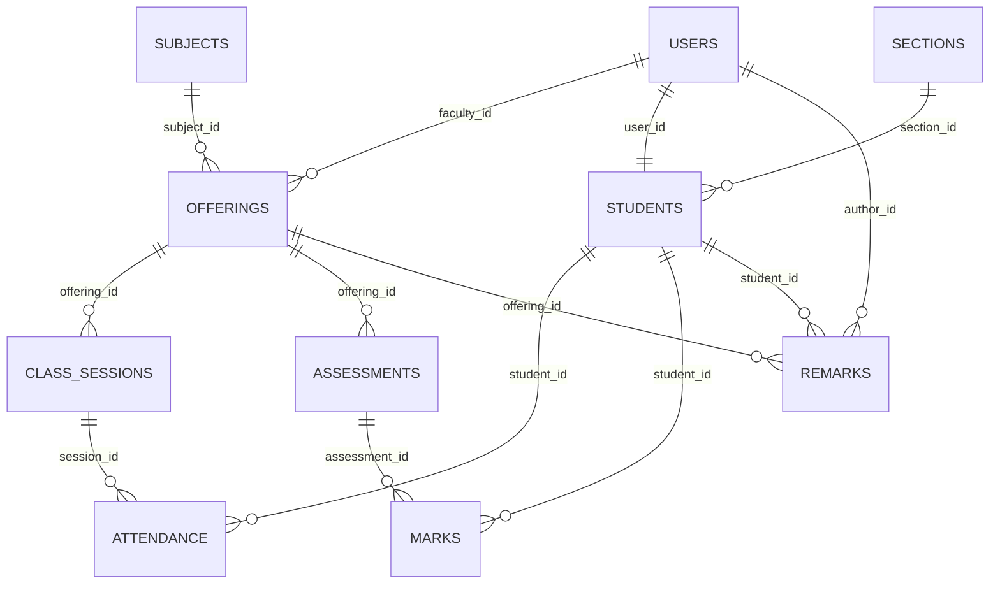

# DATABASE

## ER Diagram

## Tables
| Table | Columns (type) | Notes |
|-------|----------------|-------|
| **users** | `id` PK int auto_increment, `name` varchar(100), `email` varchar(150) UNIQUE, `password_hash` varchar(255), `role` enum('FACULTY','STUDENT'), `created_at` timestamp default CURRENT_TIMESTAMP | Auth & RBAC |
| **sections** | `id` PK, `name` varchar(50), `semester` varchar(20), `academic_year` varchar(9), UNIQUE(`name`,`semester`,`academic_year`) |
| **students** | `id` PK, `user_id` FK→users(id) UNIQUE, `usn` varchar(20) UNIQUE, `section_id` FK→sections(id) |
| **subjects** | `id` PK, `code` varchar(20) UNIQUE, `name` varchar(100), `credits` int |
| **offerings** | `id` PK, `subject_id` FK→subjects(id), `section_id` FK→sections(id), `faculty_id` FK→users(id), UNIQUE(`subject_id`,`section_id`) |
| **class_sessions** | `id` PK, `offering_id` FK→offerings(id), `session_date` date, `period` tinyint, `topic` varchar(200), `status` enum('OPEN','LOCKED') DEFAULT 'OPEN', UNIQUE(`offering_id`,`session_date`,`period`) |
| **attendance** | `id` PK, `session_id` FK→class_sessions(id), `student_id` FK→students(id), `status` enum('PRESENT','ABSENT','LATE') NOT NULL, UNIQUE(`session_id`,`student_id`) |
| **assessments** | `id` PK, `offering_id` FK→offerings(id), `title` varchar(150), `type` enum('IA','ASSIGNMENT','QUIZ'), `max_marks` decimal(5,2), `conducted_on` date, `status` enum('DRAFT','PUBLISHED') DEFAULT 'DRAFT' |
| **marks** | `id` PK, `assessment_id` FK→assessments(id), `student_id` FK→students(id), `marks_obtained` decimal(5,2) NULL, UNIQUE(`assessment_id`,`student_id`) |
| **remarks** | `id` PK, `student_id` FK→students(id), `offering_id` FK→offerings(id), `author_id` FK→users(id), `note` text, `created_at` timestamp default CURRENT_TIMESTAMP |
| **audit_log** *(optional stretch)* | `id` PK, `user_id` FK→users(id), `entity` varchar(50), `entity_id` int, `action` varchar(20), `old_value` json, `new_value` json, `created_at` timestamp default CURRENT_TIMESTAMP |

## Indexes
- `attendance(student_id)` – fast per‑student stats.
- `class_sessions(offering_id, session_date)` – lookup sessions.
- `marks(student_id)` – performance calculations.

## MySQL Specifics
- Engine: InnoDB, charset utf8mb4.
- ENUMs used for limited fields (role, status, type).
- `DECIMAL(5,2)` for marks to avoid floating errors.

## Seed Data (described in `server/prisma/seed.js`)
- 1 faculty (`faculty@demo.com` / `Password@123`).
- 1 section ("A", Semester 1, 2026‑2027).
- 3 subjects (DBMS, Algorithms, OS).
- 10 students linked to the section.
- 2 locked class sessions, 2 published assessments, 1 draft assessment.
