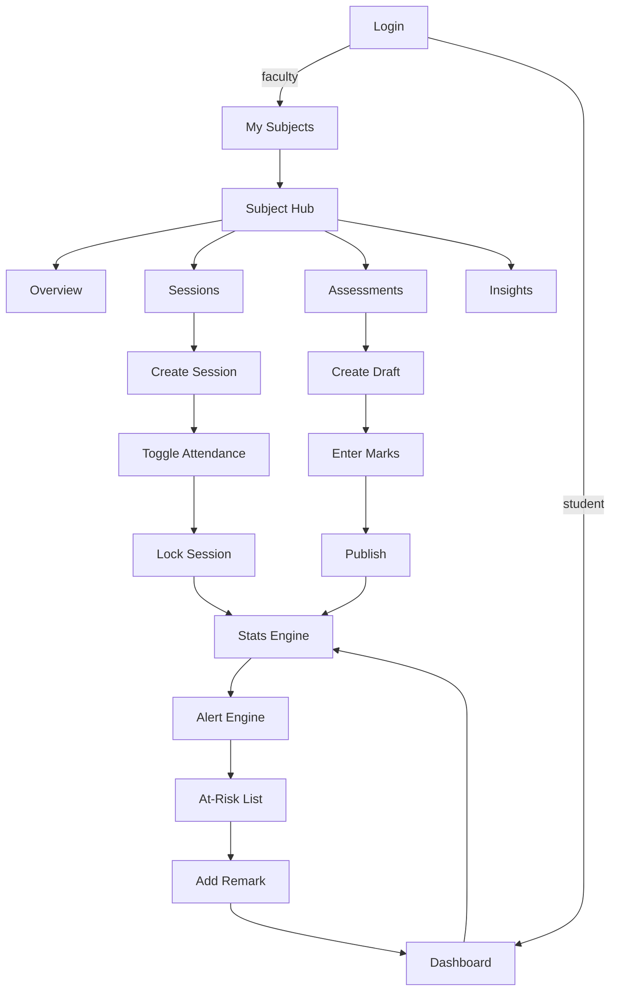
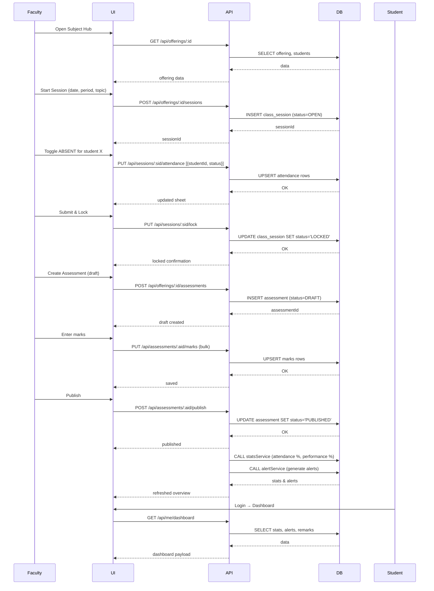

# WORKFLOW

## 5‑Stage Term Lifecycle

1. **Setup (once per term)**
   - Faculty creates **Section**, **Subject**, and an **Offering** (Subject + Section + Faculty).
   - Students are added manually or imported via CSV.

2. **Class Sessions (every class)**
   - From the *Subject Hub* a faculty member creates a session (`date`, `period`, `topic`).
   - Attendance sheet defaults to **PRESENT** for all enrolled students. Faculty toggles **ABSENT** or **LATE**.
   - Click **Submit & Lock** → session status becomes `LOCKED`. Locked sessions are read‑only unless reopened.

3. **Assessment Cycle**
   - Faculty creates an assessment in **DRAFT** (type IA/ASSIGNMENT/QUIZ, `max_marks`).
   - Marks are entered per student; `NULL` denotes absent.
   - **Publish** → status `PUBLISHED`. Only published assessments are visible to students and counted in stats.

4. **Analytics (automatic)**
   - On every lock/publish the engine recalculates:
     - **Attendance %** = (PRESENT + LATE) / total `LOCKED` sessions × 100.
     - **Subject Performance %** = Σ(obtained) / Σ(max) over published assessments where the student wasn't absent.
     - **Classes Needed** – minimal future sessions required to reach the attendance warning threshold.

5. **Intervention Loop**
   - **Alert Engine** generates:
     - `LOW_ATTENDANCE` (< ATTENDANCE_WARN = 75 % warning, < ATTENDANCE_CRITICAL = 65 % critical).
     - `LOW_MARKS` (performance % < MARKS_LOW = 40 %).
     - `DECLINING_TREND` (two consecutive assessments each lower than the previous).
   - Faculty sees an **At‑Risk** list per offering and can add **Remarks**.
   - Students view alerts and remarks on their dashboard.

## Role‑Wise Journeys
- **Faculty**: Login → My Subjects → Choose Offering → *Subject Hub* (Overview → Sessions → Assessments → Insights) → Record attendance/marks → Review analytics → Add remarks.
- **Student**: Login → Dashboard → Subject cards → Attendance & marks charts → Alerts panel.

## Mermaid Diagrams

## Business Rules & Edge Cases
- **Re‑opening a locked session** – Faculty can POST `/api/sessions/:sid/reopen` to set status back to `OPEN`.
- **Absent vs. Zero** – Marks `NULL` means absent; `0` is a valid score.
- **Mid‑term student addition** – New student rows are auto‑included in future session attendance and assessment marks; historic stats treat missing rows as `ABSENT`.
- **Late attendance** – Counted as present for % calculation.
- **Thresholds** – Configurable via env (`ATTENDANCE_WARN`, `ATTENDANCE_CRITICAL`, `MARKS_LOW`).

---

*All documents in Phase 1 are meant to be the single source of truth for subsequent development.*